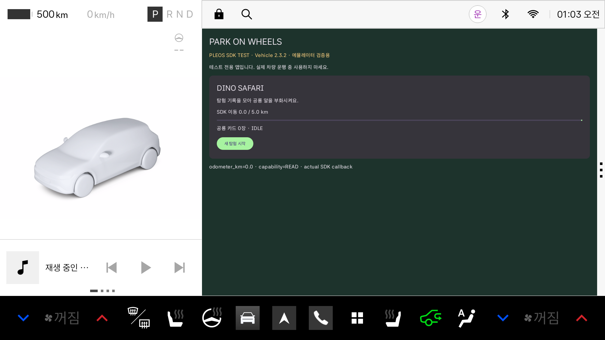

# Pleos 에뮬레이터 실행 검증

## 확인한 결과 (2026-10-27)

Pleos Connect v2.1.0 공식 x86_64 이미지(API 34)에서 SDK 테스트 APK를 실제로 설치하고 실행했습니다.

- 빌드/기존 도메인·lint 검증: [빌드 실행](https://github.com/Atelier-PJ/park_in_wheels/actions/runs/40468530876)
- 검증한 APK: 위 실행의 `tested-apks` artifact. 앱 소스는 `6119cbae33b8d79cbb170d3de73ae83864bfab80` 기준입니다.
- 실제 런타임 증거: [캡처 실행](https://github.com/Atelier-PJ/park_in_wheels/actions/runs/40469853080), `pleos-runtime-results` artifact.
- 설치 성공, Activity 시작 `Status: ok`, 실행 프로세스 PID 8652.
- 실제 화면에 PARK ON WHEELS / DINO SAFARI / 새 탐험 시작 버튼 표시.
- 실제 SDK 콜백: `odometer_km=0.0 · capability=READ · actual SDK callback`.
- 실제 차량 UX 상태: `UX=AVAILABLE · activeRestrictions=0`.

이 결과는 에뮬레이터에서의 실제 SDK 실행입니다. 실제 차량 테스트는 수행하지 않았습니다. 거리 변화, 5km 부화, 주행 제한 전환 및 연결 복구는 이번 런타임에서 검증하지 않았습니다.

**전체 캡처 실행은 실패 상태입니다.** SDK 앱 검증 후 별도로 실행한 데모 앱이 `am start -W`에서 시간 초과되어 종료됐습니다. SDK 앱 설치·화면·콜백 증거와 전체 workflow 성공 여부를 구분해야 합니다. 로그의 `ai.umos.inputmethod` 예외는 에뮬레이터 입력기 프로세스이며 SDK 앱 프로세스의 예외가 아닙니다.

## 설치 호환성 수정

기존 APK는 `android.car` 공유 라이브러리를 필수로 선언하여 공식 Pleos 이미지에서 `INSTALL_FAILED_MISSING_SHARED_LIBRARY`로 거부됐습니다. 해당 manifest 항목을 `required=false`로 바꾼 뒤 설치와 CarUxRestrictions 수신을 확인했습니다. 실제 Car API 사용과 UX 상태 확인 전 게임 차단 로직은 유지합니다.

## 클라우드에서 다시 실행하기

`.github/workflows/pleos-emulator.yml`은 수동 실행 전용입니다. main에 머지한 뒤 GitHub **Actions → Pleos SDK runtime smoke → Run workflow**에서 대상 브랜치를 선택합니다. 자동 실행이나 상시 에뮬레이터는 아닙니다.

워크플로는 현재 소스의 빌드/기존 검증 후 공식 이미지를 준비하고, SDK APK 설치·시작·프로세스 생존·거리 콜백·UX 이용 가능 로그를 검사합니다. UI XML은 차량 화면 애니메이션 때문에 idle 검사에 실패할 수 있어 보조 증거로만 수집하며, 스크린샷은 별도로 저장합니다.

최종 수동 워크플로는 검증한 빌드 단계와 SDK 실행 단계를 정리한 구성입니다. 이 최종 구성 전체를 다시 실행한 결과는 아직 없습니다. 앞선 전체 실행을 성공으로 간주하지 마세요.

실행 후 다운로드:

- `tested-apks`: 해당 실행에서 빌드한 두 APK
- `pleos-runtime-results`: SDK 화면 캡처, launch/install 결과, logcat, Car 서비스 진단

artifact 보관 기간은 14일입니다. 위 화면은 저장소에도 보존했습니다. 작업 종료 시 에뮬레이터는 종료되므로 실시간 브라우저 조작 창은 제공하지 않습니다.

## 실행 환경 주의점

공식 이미지 ZIP은 약 4.1GB이며 압축을 풀면 약 19.6GB입니다. 임시 GitHub runner에서 사용하지 않는 사전 설치 도구를 정리해 AVD 사용자 데이터 공간까지 확보합니다. 사용자 컴퓨터 파일은 삭제하지 않습니다. Linux emulator에 필요한 libpulse 등도 설치합니다.

이미지는 공식 Nexus에서 다운로드하고 게시된 SHA-1 `b4f858d5bcc6c71506d7edfc872bcb9e5a11acaa`를 검사합니다. KVM, 4GB RAM, headless 소프트웨어 GPU로 실행합니다. 이미지 다운로드·압축 해제 때문에 한 번 실행하는 데 수 분 이상 걸립니다.
